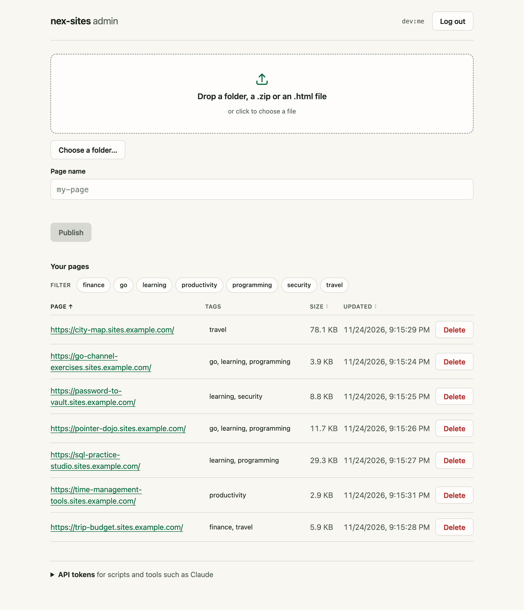
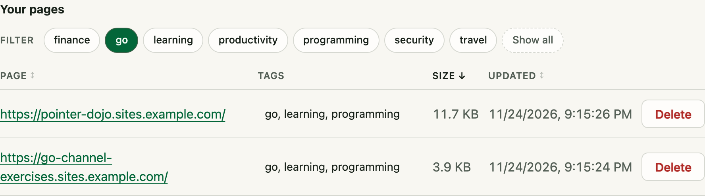
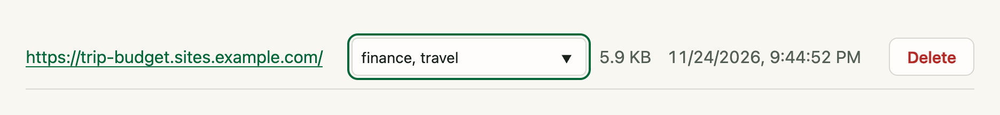
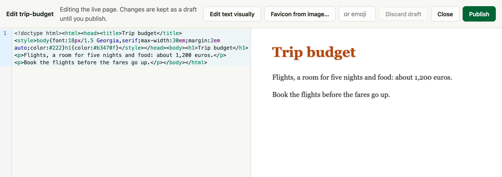
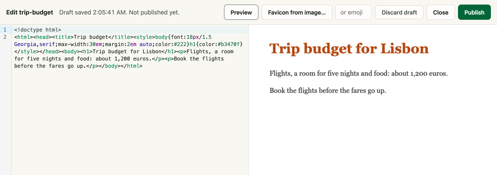
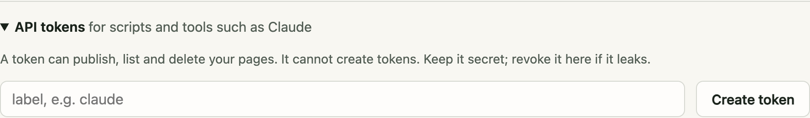

# site-publisher

Drag a folder, a `.zip` or a single `.html` file into a web page and it is live at `https://<name>.<your domain>` a
second later. One small Go binary, no database: pages and metadata are plain files. You host it yourself on any Linux
server, with any DNS provider.



## Using it

1. Log in with GitHub or Google. Only the accounts on your allowlist get in.
2. Drop a folder, a `.zip` or an `.html` file on the drop zone (or click it, or use **Choose a folder…**). The page name
   is filled in from the file name; change it if you like. The preview line shows the final URL and warns when the name
   replaces one of your pages.
3. Press **Publish**. The page is served at `https://<name>.<PAGES_DOMAIN>/`. A folder or zip needs an `index.html` at
   its top level; a lone `.html` file becomes `index.html`.

**Sort and filter.** Click **Page**, **Size** or **Updated** to sort, click again to reverse. Click a tag chip to show
only the pages with that tag; select several chips to narrow further, **Show all** clears the filter.



**Tags.** Type tags into a page's Tags field, separated by commas; they save when you leave the field. Tags are
lowercase `a-z`, `0-9` and `-`, up to 10 per page, and survive republishing the page. The field suggests tags you
already use plus a few starters.



**Edit and create pages.** **Edit** on a page row opens its `index.html` in a code editor with HTML highlighting, next
to a live preview. **New page** starts from a small template. Every change is saved as a draft on the server a moment
after you stop typing; the live page changes only when you press **Publish**, so you can close the editor and continue
later (the row shows a "draft" badge, and drafts of new pages are listed above the table). **Discard draft** throws your
changes away. **Favicon from image…** or an emoji embeds a favicon into the page as a `data:` URL, replacing any it had,
and leaves the rest of the HTML byte for byte as it was. If the page was republished after you opened it, Publish asks
before overwriting that newer version. The preview runs the page's own scripts in a sandbox that cannot reach the admin.
**Edit text visually** lets you click into the page and type; it appears only for pages without scripts, and the result
lands in the source so you can review it before you publish (the markup may be reformatted).





**API tokens.** Open **API tokens** to create a token for scripts or an AI agent. A token can publish, list, tag and
delete your pages, but cannot create more tokens. It is shown once; revoke it here if it leaks.



```bash
T=...  # the token
ADMIN=https://admin.sites.example.com
curl -H "Authorization: Bearer $T" -F name=hello -F path=index.html -F file=@index.html $ADMIN/api/pages  # publish
curl -H "Authorization: Bearer $T" $ADMIN/api/pages                                                       # list
curl -H "Authorization: Bearer $T" -X PUT -d '["notes","go"]' $ADMIN/api/pages/hello/tags                 # tag
curl -H "Authorization: Bearer $T" -X DELETE $ADMIN/api/pages/hello                                       # delete
curl -H "Authorization: Bearer $T" $ADMIN/api/pages/hello/source                                          # get index.html
curl -H "Authorization: Bearer $T" -X PUT -d '{"html":"<h1>v2</h1>"}' $ADMIN/api/drafts/hello             # save a draft
curl -H "Authorization: Bearer $T" -X POST $ADMIN/api/drafts/hello/publish                                # publish it
```

For a folder, send one `path` field and one `file` part per file, in the same order (`path` keeps the folder layout).

## Self-hosting

What you need:

- A Linux server with a public IPv4 address, from any provider: a VPS (Hetzner, DigitalOcean, Linode), a cloud VM (AWS
  EC2 or Lightsail, Google Compute Engine, Azure, Oracle Cloud free tier) or a machine at home with ports forwarded. 1
  CPU and 512 MB of RAM are enough; `amd64` and `arm64` both work. A Mac with Docker Desktop, colima or OrbStack also
  runs the stack (`make e2e` does, below), but a server is the better host: a laptop sleeps, and a home network needs
  ports 80 and 443 forwarded to it.
- Ports 80 and 443 open to the internet, in the provider's firewall (security group, VCN security list) and on the
  server itself.
- Docker with the compose plugin on the server: <https://docs.docker.com/engine/install/>. The ssh user must be able to
  run `docker` (root, or a member of the `docker` group).
- A domain whose DNS you can edit, at any provider (next section), or a free DuckDNS name.
- On your own machine: `ssh`, `tar` and Python 3.11 or newer.

The stack in `deploy/` is two containers: the admin, and [Caddy](https://caddyserver.com) serving the pages and getting
HTTPS certificates from Let's Encrypt. Pages and certificates live in Docker volumes, so redeploying keeps them.

### 1. DNS (any provider)

Pick a domain for pages, for example `sites.example.com`, and point two `A` records at the server's IP:

| Name                  | Type | Value         | Why                                        |
| --------------------- | ---- | ------------- | ------------------------------------------ |
| `sites.example.com`   | `A`  | the server IP | The bare domain (shows a "no page" screen) |
| `*.sites.example.com` | `A`  | the server IP | Every page and the admin                   |

The admin lives at `admin.sites.example.com`, which the wildcard already covers (`admin` is a reserved page name). Use
your apex domain (`example.com` and `*.example.com`) if the domain is only for pages.

Any DNS provider works, because Caddy proves domain ownership over plain HTTP (HTTP-01) for each page name on its first
visit. It needs no wildcard certificate and no DNS API token. Examples:

| Provider                  | How                                                                                 |
| ------------------------- | ----------------------------------------------------------------------------------- |
| Cloudflare                | Add `A` records `sites` and `*.sites`, proxy status **DNS only**                    |
| AWS Route 53              | Hosted zone, Create record: `sites` and `*.sites`, type `A`                         |
| Google Cloud DNS          | `gcloud dns record-sets create NAME --type=A --zone=Z --rrdatas=IP`, for both names |
| Namecheap, Porkbun, etc.  | Advanced DNS: `A` records with host `sites` and `*.sites`                           |
| DuckDNS (free, no domain) | `*.myname.duckdns.org` resolves too: `PAGES_DOMAIN=myname.duckdns.org`              |

With a dynamic home IP, keep the records current with your provider's updater (DuckDNS and Cloudflare both have one).

Check DNS before deploying (it reads `deploy/.env` from step 3):

```bash
make dns-check                              # all names resolve to one address
python3 scripts/dns_check.py 203.0.113.7    # ... and it is this one
```

### 2. Login provider

Create at least one OAuth app and note its client ID and secret.

- GitHub: Settings, Developer settings, OAuth Apps, New OAuth App. Homepage `https://admin.sites.example.com`, callback
  `https://admin.sites.example.com/auth/github/callback`.
- Google: Cloud console, APIs and Services, Credentials, OAuth client ID (Web application). Authorized redirect URI
  `https://admin.sites.example.com/auth/google/callback`.

Your allowlist identity is `github:<numeric user id>` (from `https://api.github.com/users/<login>`) or `google:<sub>`.
If you do not know it, log in once: the admin shows the identity it refused.

### 3. Configure

```bash
cp deploy/.env.example deploy/.env   # git-ignored
openssl rand -hex 32                 # paste as SESSION_KEY
$EDITOR deploy/.env                  # PAGES_DOMAIN, ADMIN_HOST, ACME_EMAIL, ALLOWLIST, OAuth IDs
```

### 4. Deploy

```bash
make deploy HOST=root@203.0.113.7    # or any Host alias from ~/.ssh/config
```

`scripts/ssh_deploy.py` copies `src/` and `deploy/` to `~/site-publisher` on the server and runs
`docker compose up -d --build` there. The image is built on the server, so its CPU type does not matter. Run the same
command to update. Then open `https://admin.sites.example.com`, log in and publish a page. The first visit to a page
takes a second or two longer while Caddy gets its certificate.

Without the script, on the server itself:

```bash
git clone https://github.com/Lanskask/static-sites-publisher.git site-publisher
cd site-publisher/deploy && cp .env.example .env && $EDITOR .env
docker compose up -d --build
```

### Operations

| Task         | Command (on the server, in `deploy/`)                                                 |
| ------------ | ------------------------------------------------------------------------------------- |
| Logs         | `docker compose logs -f`                                                              |
| Back up data | `docker run --rm -v deploy_sites:/d -v "$PWD":/b alpine tar czf /b/sites.tgz -C /d .` |
| Restore      | Stop the stack, then the same `docker run` with `tar xzf /b/sites.tgz -C /d`          |
| Stop         | `docker compose down` (pages are kept; `down -v` deletes the volumes)                 |

Notes:

- Let's Encrypt limits how many certificates one registered domain gets per week (50 at the time of writing; check their
  rate-limit page). Each page uses one certificate, renewed automatically. For hundreds of pages, switch Caddy to one
  wildcard certificate with a DNS-provider plugin (<https://caddyserver.com/docs/automatic-https#dns-challenge>).
- A page name that is not published gets no certificate, so its URL shows a browser TLS error instead of the "no page"
  screen. This stops strangers from making the server request certificates for random names.
- Before you let other people upload, read `docs/PUBLIC-SERVICE.md`: phishing and malware on your domain are the real
  risks.

### Without Docker

`make build GOARCH=arm64` (or `amd64`) writes a static binary to `bin/sites-admin`. Run it with the variables below (for
example as a systemd service), put any reverse proxy with TLS in front of it, and serve `SITES_DIR/pages/<name>/` as
static files for `<name>.PAGES_DOMAIN`. `deploy/Caddyfile` shows the routing.

## Configuration

| Variable                                   | Meaning                                                        |
| ------------------------------------------ | -------------------------------------------------------------- |
| `PAGES_DOMAIN`                             | Domain pages are served under                                  |
| `ADMIN_HOST`                               | The admin's host name (Docker setup; sets `BASE_URL`)          |
| `ACME_EMAIL`                               | Let's Encrypt account email (Docker setup)                     |
| `BASE_URL`                                 | The admin's own origin, used for OAuth callbacks and CSRF      |
| `SITES_DIR`                                | Where pages, metadata and tokens live (default `./data`)       |
| `ALLOWLIST`                                | Comma-separated identities allowed in                          |
| `SESSION_KEY`                              | HMAC key for session cookies, at least 32 bytes                |
| `GITHUB_CLIENT_ID`, `GITHUB_CLIENT_SECRET` | GitHub login; leave empty to hide it                           |
| `GOOGLE_CLIENT_ID`, `GOOGLE_CLIENT_SECRET` | Google login; leave empty to hide it                           |
| `CLAMD_ADDR`                               | Optional `host:port` of a clamd daemon to scan uploads         |
| `DEV_IDENTITY`                             | Fixed login for local runs; ignored unless `BASE_URL` is local |
| `ADDR`                                     | Listen address (default `:8080`)                               |

Limits per user (set in `src/main.go`): 30 pages, 20 MB per page, 300 MB in total, 2000 files per page.

## Development

```bash
make          # list the commands
make run      # http://localhost:8080 with a fake login (dev:me), data in ./data
make test     # go vet, golangci-lint, go test -race, Python script tests
make build    # static Linux binary in bin/ (GOARCH=amd64 by default)
make e2e      # the whole deploy/ stack on local Docker, with certificates from Pebble
```

`make e2e` builds the admin image, starts Caddy, and points it at [Pebble](https://github.com/letsencrypt/pebble), Let's
Encrypt's test server, with a fake DNS server that sends every name to Caddy. It then checks over real HTTPS: a
published page gets a certificate and is served, an unpublished name gets none, the admin and the 404 page work, and
HTTP redirects to HTTPS. Real Let's Encrypt cannot reach your laptop, so this is the closest local test; `KEEP=1` leaves
the stack running. `docs/screenshots/take.py` retakes the screenshots above, and `scripts/editor_check.py` checks the
page editor in Chrome (its docstring has the command). `make vendor-editor` rebuilds the bundled CodeMirror from
`tools/codemirror/`.

To test the self-hosting steps for real (DNS, Let's Encrypt, OAuth), `deploy/e2e/gcp/main.tf` creates a throwaway Google
Compute Engine VM with Docker: `make tf-plan-apply GCP_PROJECT=<id>` shows the plan, asks, and prints the ssh target;
`make tf-destroy GCP_PROJECT=<id>` deletes it. It needs `gcloud auth application-default login` once. `make gcp-e2e`
does the whole test in one go (VM, DuckDNS, deploy, checks, your GitHub login, destroy); it first lists anything it
needs and is missing.

| Path          | Purpose                                                                                              |
| ------------- | ---------------------------------------------------------------------------------------------------- |
| `src/`        | The Go service: `main.go` (config, routes), `auth.go`, `store.go`, ...                               |
| `src/static/` | The admin UI, embedded in the binary                                                                 |
| `deploy/`     | `Dockerfile`, `compose.yaml`, `Caddyfile`, the 404 page, `.env.example`                              |
| `scripts/`    | `ssh_deploy.py`, `dns_check.py`, `e2e.py`, `editor_check.py` (browser check of the editor) and tests |
| `docs/`       | Notes on running it as a public service; the README screenshots                                      |

## License

MIT, see [LICENSE](LICENSE).
